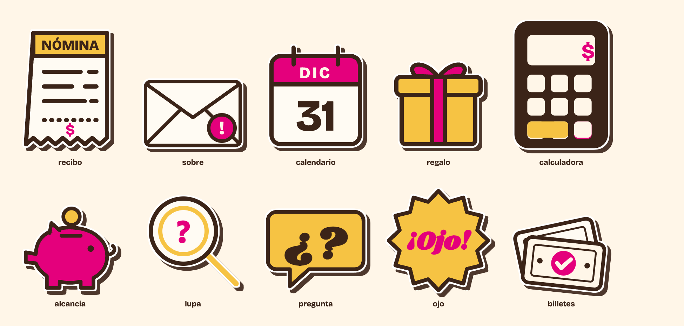

# Stickers de Cuentas Claras

Calcomanías de la libreta: trazo cacao, rosa y maíz de acento, borde blanco de recorte y sombra dura
cacao. Nacieron para el primer live (2026-10-28, Israel: "vamos a quitarle lo serio, lo aburrido, lo
formal") y sirven para todo lo visual: slides, posts, miniaturas y edición de video.



| Archivo | Qué es | Dónde va |
|---|---|---|
| `recibo` | Recibo de NÓMINA con dientes y el $ | Sueldo, retenciones, constancia |
| `sobre` | Sobre con el sello rosa "!" | Una carta o aviso del SAT, el buzón |
| `calendario` | DIC 31 | Fechas límite, "antes del 31" |
| `regalo` | Caja maíz con moño rosa | Aguinaldo, prestaciones |
| `calculadora` | Calculadora cacao con el $ rosa | Cualquier ejemplo con números |
| `alcancia` | Cochinito rosa con la moneda | Ahorro, Afore, saldo a favor |
| `lupa` | Lupa con "?" | Revisar, "¿cuenta o no cuenta?" |
| `pregunta` | Burbuja maíz "¿?" | La duda del episodio, preguntas del chat |
| `ojo` | Estrella maíz "¡Ojo!" | Advertencias, el error común |
| `billetes` | Dos billetes, el de enfrente palomeado | Dinero, devoluciones (el símbolo de la marca) |

## Formatos

- **`png/`**: la calcomanía completa, fondo transparente, unos 1,000 px de ancho. Es la que se usa en
  edición de video (Premiere, CapCut, Remotion, hyperframes) y en posts.
- **`svg/`**: el dibujo limpio, sin borde ni sombra, para HTML. Las letras usan Bricolage Grotesque y
  Shrikhand por nombre, así que la página tiene que tener cargadas las fuentes de la marca. El trato
  de calcomanía se pone en css:

  ```css
  .sticker { filter: drop-shadow(4px 0 0 #fff) drop-shadow(-4px 0 0 #fff) drop-shadow(0 4px 0 #fff)
             drop-shadow(0 -4px 0 #fff) drop-shadow(10px 10px 0 rgba(59,36,24,.9)); }
  ```

## Reglas

- **Solo donde no está la cámara.** En una pantalla con el cuadro de OBS, la derecha es de la cámara
  y ahí no se pega nada.
- **Uno o dos por pantalla**, girados entre -10° y 10°, sin tapar texto ni cifras.
- **Entran al final**, se pegan con un rebote corto (en slides: `cc-pega` en
  `social-studio/brands/cuentas-claras/css/escenario-entradas.css`). Nunca siguen al cursor.
- **No llevan texto nuevo.** Si hace falta una palabra, va en la pieza, no en el sticker.

## De dónde salen

La fuente es una sola: `social-studio/brands/cuentas-claras/templates/stickers.mjs`. Para agregar uno
se dibuja ahí y se vuelve a exportar esta carpeta:

```bash
cd ../social-studio && node scripts/stickers.mjs
```
